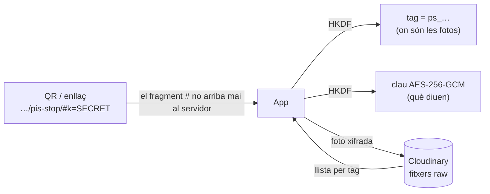

# Pis Stop 🍻

[](https://github.com/MarcLlobet/pis-stop/actions/workflows/ci.yml)

El mapa de fotos privat del vostre **correpisos**: una colla d’amics fa ruta pels pisos de tothom,
i a cada parada pengeu fotos que queden clavades al mapa.

- **Sense backend.** Una web estàtica a GitHub Pages i Cloudinary com a magatzem.
- **Privat de debò.** Les fotos i les metadades es xifren al mòbil (AES-GCM) abans de pujar-les.
  Cloudinary només guarda soroll.
- **Accés per QR.** La clau viatja dins l’enllaç del QR; no s’ha d’escriure cap codi.
- **Codi obert, events privats.** El repo és públic, el build és públic, i tot i així ningú sense el
  QR pot veure ni trobar les fotos.

👉 **Demo:** <https://marcllobet.github.io/pis-stop/> → «Prova la demo».

## Com funciona



1. L’organitzador executa `npm run event:create` amb la llista de pisos. Es genera un secret
   aleatori de 256 bits, es pugen els pisos xifrats i surt un **enllaç + QR**.
2. Qui escaneja el QR obre l’app amb el secret al fragment (`#k=…`). L’app el guarda al
   dispositiu i l’esborra de la barra d’adreces.
3. Del secret se’n deriven dues coses amb HKDF:
   - el **tag** de Cloudinary on es llisten les entrades de l’event;
   - la **clau AES** que xifra cada entrada i cada foto.
4. Cada foto es redimensiona al mòbil (cosa que també n’elimina l’EXIF), es xifra i es puja. Una
   entrada xifrada a part conté la miniatura, l’autor, la ubicació i el pis més proper.
5. Per carregar l’event, l’app demana a Cloudinary el llistat del tag, ho baixa i ho desxifra.

### Model de seguretat

| Qui                                      | Què pot fer                                                        |
| ---------------------------------------- | ------------------------------------------------------------------ |
| Algú amb el QR                           | Veure-ho tot i penjar fotos (mentre l’event sigui obert)           |
| Algú amb el codi de la web però sense QR | Res de l’event: no sap el tag ni la clau                           |
| Algú amb el nom del compte i el preset   | Pujar fitxers al compte mentre el preset existeixi, però no llegir |
| Cloudinary                               | Veure blobs xifrats i quan es pugen                                |

Límits que cal conèixer: el secret és compartit (no es pot expulsar ningú), i una captura del QR
funciona per sempre. Per tancar l’event, esborra el preset de pujada (vegeu més avall).

## Posar-ho en marxa

### 1. Cloudinary (gratuït)

1. Crea un compte a [Cloudinary](https://cloudinary.com/).
2. **Settings → Upload → Upload presets → Add upload preset**:
   - _Signing mode_: **Unsigned**.
   - Opcional: una carpeta, per exemple `pis-stop`.
3. **Settings → Security → Restricted media types**: desmarca **Resource list**, perquè l’app
   pugui llistar les entrades per tag.

### 2. Configuració

```bash
cp .env.example .env
# VITE_CLOUDINARY_CLOUD_NAME=<el teu cloud name>
# VITE_CLOUDINARY_UPLOAD_PRESET=<el preset unsigned>
# APP_URL=https://<usuari>.github.io/pis-stop/
```

Aquests valors **no són secrets**: acaben dins del JavaScript públic. A GitHub, posa’ls com a
_repository variables_ (`Settings → Secrets and variables → Actions → Variables`) amb els noms
`CLOUDINARY_CLOUD_NAME` i `CLOUDINARY_UPLOAD_PRESET`. Sense aquestes variables, el deploy surt en
mode només-demo.

### 3. Crear l’event

```bash
cp event.example.json event.json   # event.json està al .gitignore
# edita el nom i els pisos (nom, lat, lng)
npm run event:create -- event.json
```

Surt l’enllaç d’invitació i un QR a `out/`. Comparteix-los només amb el grup.
Per afegir pisos a un event existent: `npm run event:create -- altres.json --secret <secret>`.

### 4. Tancar l’event

Esborra (o desactiva) l’upload preset a Cloudinary. Les fotos es continuen veient amb el QR, però
ja no se’n poden penjar més.

## Desenvolupament

```bash
npm install
npm run dev        # http://localhost:5173
npm run check      # prettier + eslint + tsc + tests amb cobertura
npm run build
```

| Eina                         | Per què                                                                |
| ---------------------------- | ---------------------------------------------------------------------- |
| Vite + React 19 + TypeScript | Build ràpid, tipat estricte (`exactOptionalPropertyTypes`, etc.)       |
| Tailwind CSS 4               | Estils sense CSS a mida                                                |
| Leaflet + OpenStreetMap      | Mapa lleuger i sense clau d’API                                        |
| WebCrypto                    | HKDF + AES-GCM natius del navegador, zero dependències criptogràfiques |
| Vitest + Testing Library     | Unit tests de la lògica i dels components                              |
| ESLint (strict type-checked) | `typescript-eslint` strict, `functional`, `jsx-a11y`, imports ordenats |

### Estructura

```
src/
├─ lib/         lògica pura i testejada: xifratge, empaquetat, Cloudinary, geo, snapshot
├─ platform/    adaptadors fins sobre APIs del navegador (canvas, geolocalització, storage)
├─ hooks/       estat de React (sessió, event, pujades)
└─ components/  UI
scripts/        CLI per crear events i el QR
```

El codi és funcional i immutable (`functional/no-let`, `functional/immutable-data`, sense classes
ni bucles). La UI no coneix Cloudinary: parla amb un `EventRepository`, del qual hi ha dues
implementacions, la real i la de demo.

## Llicència

MIT
