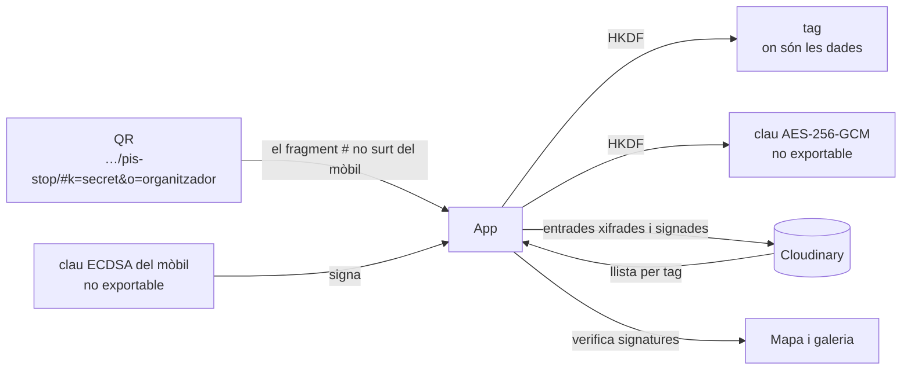

# Pis Stop 🍻

[](https://github.com/MarcLlobet/pis-stop/actions/workflows/ci.yml)
[](https://github.com/MarcLlobet/ts-only)
[](https://securityscorecards.dev/viewer/?uri=github.com/MarcLlobet/pis-stop)

El mapa de fotos privat del vostre **correpisos**: una colla d’amics fa ruta pels pisos de tothom,
i a cada parada pengeu fotos que queden clavades al mapa.

- **Sense backend.** Una web estàtica a GitHub Pages i Cloudinary com a magatzem.
- **Xifrat al mòbil.** AES-256-GCM amb claus no exportables: Cloudinary només guarda soroll.
- **Signat al mòbil.** Cada persona té una clau ECDSA pròpia: ningú pot penjar fotos en nom d’un
  altre, ni tan sols algú del grup.
- **Accés per QR.** La clau del grup viatja dins l’enllaç; no s’ha d’escriure cap codi.
- **Auditable.** [SECURITY.md](SECURITY.md) explica què protegeix i què no, i com comprovar-ho
  tu mateix. [docs/PROTOCOL.md](docs/PROTOCOL.md) és l’especificació exacta, amb vectors de prova
  que una implementació independent en Python reprodueix.

Sense invitació, l’app no ensenya res: només deixa escanejar el QR o enganxar l’enllaç. La demo surt
només en un desplegament sense compte de Cloudinary configurat, i `pnpm dev` hi entra directament.

## Com funciona



1. L’organitzador crea l’event amb `pnpm event:create`. Surt un **QR** i un fitxer amb la seva
   clau d’organitzador, que signa la llista de pisos.
2. Qui escaneja el QR (amb la càmera o des de l’app) obté la clau del grup. El mòbil la converteix
   en claus no exportables, guarda la invitació per poder-la tornar a ensenyar (**Convida**) i
   n’esborra el rastre de la barra d’adreces.
3. En fer-se el perfil, el mòbil genera una clau de signatura pròpia. L’identificador de la
   persona és l’empremta d’aquesta clau.
4. Cada foto es redimensiona (i perd l’EXIF), es signa, es xifra i es puja.
5. En obrir l’app, es descarrega tot, es desxifra, es verifica i es descarta el que no quadra.

## Posar-ho en marxa

### 1. Cloudinary (gratuït)

1. Crea un compte a [Cloudinary](https://cloudinary.com/).
2. **Settings → Upload → Upload presets → Add upload preset**, amb _Signing mode_ **Unsigned**.
3. **Settings → Security → Restricted media types**: desmarca **Resource list**, perquè l’app
   pugui llistar les entrades per tag.

### 2. Ubicació en viu (opcional)

Perquè la colla es pugui veure al mapa mentre dura l’event, amb un compte gratuït d’
[Ably](https://ably.com/) (pensat per a això: cap servidor propi, cap targeta):

1. Crea un compte i una app a Ably.
2. **API Keys → Settings** de la clau, i restringeix-la: patró de recurs **`location:*`**,
   capacitats **publish**, **subscribe** i **presence** (res més).
3. Aquesta clau xifrada i signada igual que les fotos: Ably només hi veu soroll. Si no la poses,
   el botó de compartir ubicació simplement no surt.

### 3. Configuració

```sh
cp .env.example .env
# VITE_CLOUDINARY_CLOUD_NAME=<el teu cloud name>
# VITE_CLOUDINARY_UPLOAD_PRESET=<el preset unsigned>
# VITE_ABLY_KEY=<la clau restringida, opcional>
# APP_URL=https://<usuari>.github.io/pis-stop/
```

Aquests valors **no són secrets**. A GitHub, posa’ls com a _repository variables_
(`Settings → Secrets and variables → Actions → Variables`) amb els noms `CLOUDINARY_CLOUD_NAME`,
`CLOUDINARY_UPLOAD_PRESET` i, si vols ubicació en viu, `ABLY_KEY`. Sense les dues primeres, el
deploy surt en mode només-demo. A `Settings → Pages`, tria **GitHub Actions** com a font.

### 4. Generar el mapa

El mapa no ve de cap servidor extern: és un extracte de la zona de l’event que es publica amb la
web. A GitHub, **Actions → Update map → Run workflow** (per defecte, Barcelona; pots posar una
altra zona com a `oest,sud,est,nord`). El fitxer es desa a `public/map/area.pmtiles` i es
torna a desplegar sol.

En local també es pot fer amb `pnpm map:extract` (cal `pmtiles` o Go instal·lat). Mentre no
existeixi, `pnpm dev` fa servir les tessel·les d’OpenStreetMap.

### 5. Itinerari amb el metro real (opcional)

Escriu a `event.json` com vas d’un pis a l’altre (línies i estacions, a peu, en bici) i executa:

```sh
pnpm event:route event.json
```

Amb dades obertes d’OpenStreetMap, sense clau ni targeta: el metro segueix la via real entre les
estacions que has escrit (amb els transbords) i els trams a peu i en bici segueixen els carrers. Ho
desa a `event.json` i ho veus amb `pnpm dev`.

Si prefereixes que ho planifiqui Google (horaris reals, transbords que no has escrit), amb una
clau de la Routes API a `GOOGLE_MAPS_API_KEY`:

1. [Activa la Routes API](https://console.cloud.google.com/apis/library/routes.googleapis.com)
   (demana un compte de facturació).
2. [Crea una clau](https://console.cloud.google.com/apis/credentials) i limita-la a **Routes API**.
3. `pnpm event:route event.json --provider google --departure 2026-12-12T18:00`

Només s’executa al teu ordinador: la web no contacta mai cap d’aquests serveis.

### 6. Crear l’event

```sh
cp event.example.json event.json   # event.json està al .gitignore
pnpm event:create event.json
```

Surten l’enllaç d’invitació, el QR i `out/<event>.keys.json`. Guarda aquest últim fora de línia.
Per afegir pisos més tard: `pnpm event:create mes-pisos.json --keys out/<event>.keys.json`.

Pots fer tants events com vulguis amb la mateixa web: cada un té la seva clau, i des d’un no es
pot veure ni saber res d’un altre. Al mòbil, **Els meus events** (l’avatar de dalt) els llista i
permet canviar-ne o afegir-ne un altre.

Amb `CLOUDINARY_API_KEY` i `CLOUDINARY_API_SECRET` a `.env` (Cloudinary → **Settings → API
Keys**; són secrets, només per al teu ordinador), cada event té el seu propi upload preset, amb un
nom aleatori que només viatja xifrat dins l’event. Així ningú de fora del grup hi pot pujar res, i
cada event es tanca per separat.

### 7. Votar les tapes (opcional)

Cada pis pot tenir una tapa, valorada d’1 a 5 estrelles en presentació, originalitat, sabor i
elaboració. Perquè l’organitzador pugui obrir i tancar les votacions **des del mòbil** sense dur-hi
la seva clau, la delega en un perfil:

```sh
pnpm event:host --keys out/<event>.keys.json            # llista qui s’ha unit
pnpm event:host --keys out/<event>.keys.json "<nom>"    # li dona el control
```

(Cal el perfil fet a l’app abans, i `VITE_CLOUDINARY_*` a l’entorn.) A l’app, l’amfitrió veu a
l’estrella de dalt una llista de pisos amb **Obre** i **Tanca**. Quan n’obre un, a tothom li surt
la targeta per votar. Els resultats només es veuen quan el pis està tancat.

### 8. Esborrar fotos i vots

```sh
pnpm event:wipe --keys out/<event>.keys.json --votes --photos        # només compta
pnpm event:wipe --keys out/<event>.keys.json --votes --photos --yes  # esborra
```

Esborra les fotos (miniatures i originals) i/o els vots d’un event, per començar net. No toca
l’event, les parades ni els perfils. Cal `CLOUDINARY_API_KEY` i `CLOUDINARY_API_SECRET` a `.env`, i
no es pot desfer.

### 9. Tancar l’event

```sh
pnpm event:close --keys out/<event>.keys.json
```

Esborra el preset de l’event: les fotos es continuen veient, però ja no se’n poden penjar més. Els
altres events no canvien. Un event creat sense les claus de l’API fa servir el preset compartit
(`VITE_CLOUDINARY_UPLOAD_PRESET`): esborrar-lo a Cloudinary els tanca tots alhora.

### 10. Guardar-te totes les fotos

```sh
pnpm event:export --keys out/<event>.keys.json   # → out/<event>-fotos/
```

Les baixa, les desxifra i comprova la signatura i el hash de cadascuna, com fa l’app. Surten
com a JPEG amb el nom de qui la va fer i l’hora (`001-2026-12-12_21-04-33-julia.jpg`, amb aquesta
data com a data del fitxer) i un `fotos.json` amb autor, hora i posició. Si el tornes a executar,
només afegeix les noves. Ho pots fer abans de tancar o d’esborrar res. Aquesta carpeta té les
fotos **en clar**: guarda-la amb la mateixa cura que el fitxer de claus.

## Desenvolupament

```sh
corepack enable    # usa la versió de pnpm de package.json
pnpm install
pnpm dev           # http://localhost:5173
pnpm check         # ts-only + prettier + eslint + tsc + tests amb cobertura
pnpm build
```

| Eina                                                         | Per què                                                                               |
| ------------------------------------------------------------ | ------------------------------------------------------------------------------------- |
| pnpm                                                         | Instal·lacions estrictes, sense scripts no aprovats ni versions de fa menys de 3 dies |
| Vite + React 19 + TypeScript                                 | Tipatge estricte (`exactOptionalPropertyTypes`, `noUncheckedIndexedAccess`…)          |
| [Untitled UI](https://www.untitledui.com/react) + React Aria | Components accessibles i icones `@untitledui/icons`                                   |
| Tailwind CSS 4                                               | El sistema de tokens d’Untitled UI, amb el color de marca de Pis Stop                 |
| Leaflet + Protomaps                                          | Mapa vectorial allotjat a la mateixa web: cap servidor de mapes extern                |
| Ably (opcional)                                              | Ubicació en viu, només bytes xifrats i signats: carregat sota demanda                 |
| WebCrypto                                                    | HKDF, AES-GCM, ECDSA i SHA-256 natius: cap criptografia feta a mà                     |
| Vitest + Testing Library                                     | Proves de la lògica (95% de cobertura mínima a `src/lib`) i dels components           |
| ESLint strict type-checked                                   | `typescript-eslint`, `functional`, `jsx-a11y`, i res d’`innerHTML`                    |
| [ts-only](https://github.com/MarcLlobet/ts-only)             | Ni un fitxer de JavaScript al repositori                                              |

### Estructura

```
src/
├─ lib/          lògica pura i provada: xifratge, signatures, format, verificació, Cloudinary
├─ platform/     adaptadors fins sobre APIs del navegador (canvas, geolocalització, IndexedDB)
├─ hooks/        estat de React (sessió, identitat, event, pujades)
├─ app/          pantalles de l’app
├─ components/   Untitled UI, copiat sense canvis (vegeu THIRD_PARTY_NOTICES.md)
├─ utils/        utilitats d’Untitled UI
└─ styles/       tema d’Untitled UI i estils globals
scripts/         CLI de l’organitzador, manifest del build, verificació en Python
docs/            especificació del protocol
```

El codi propi és funcional i immutable (`functional/no-let`, `functional/immutable-data`, sense
classes ni bucles). La UI no coneix Cloudinary: parla amb un `EventRepository`, amb dues
implementacions, la real i la de demo.

## Llicència

MIT. Els components d’Untitled UI també són MIT (vegeu [THIRD_PARTY_NOTICES.md](THIRD_PARTY_NOTICES.md)).
